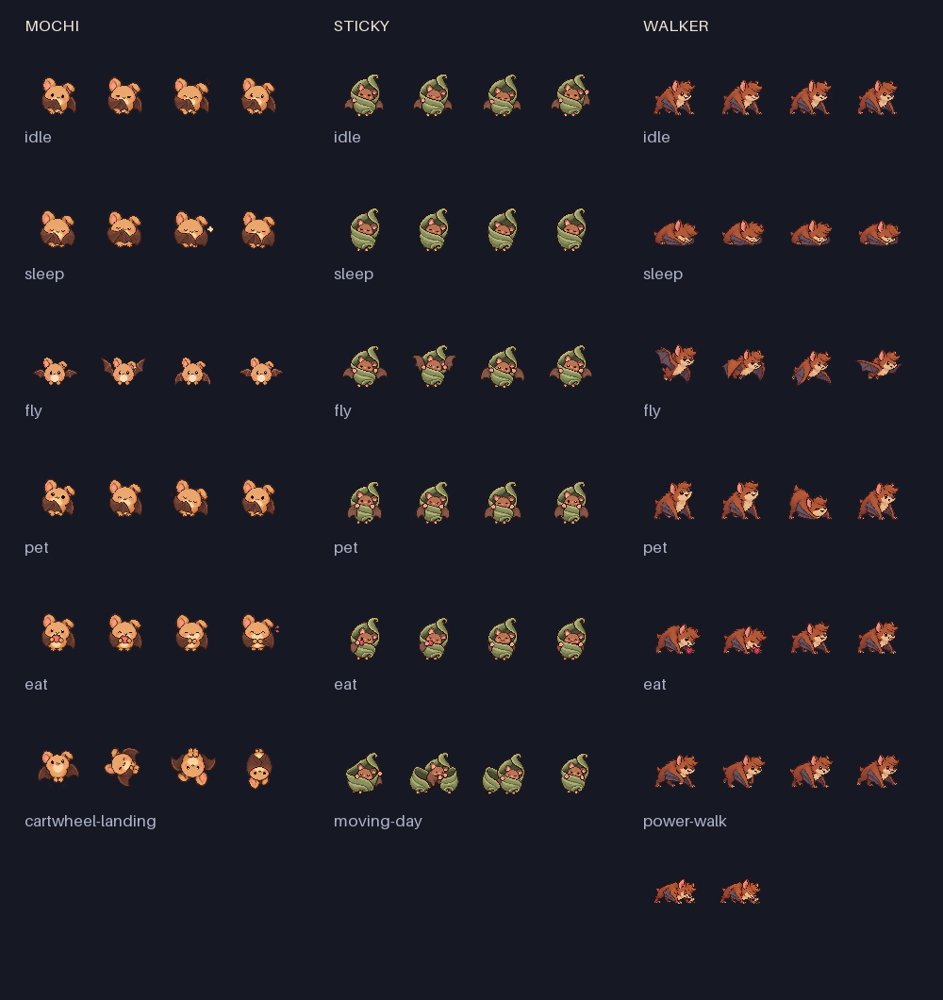

# Gentle pixel · 三只动画样板

麻薯、吸盘、步行：**18 段动作 / 74 帧**。每只五个通用动作和一个 Lv.4 招牌动作，
依据已确认的独立角色立绘与 `ActionCatalog` 制作。步行的快走包含两帧喝花蜜收尾。

- 原始帧表：`mochi-sheet-v1.png`、`sticky-sheet-v1.png`、`walker-sheet-v1.png`。
- 正式使用的 Mochi 飞行修正版：`mochi-fly-v2.png`；原帧表的飞行行保留作来源记录，不打包。
- Walker 收尾：`walker-nectar-v1.png`。
- [74 张逻辑帧](frames-64px/)，[帧与裁切清单](manifest.json)。
- 使用内置 imagegen 生成：[首批提示词](prompts.json)、[飞行修正](mochi-fly-prompt.txt)、[花蜜收尾](walker-nectar-prompt.txt)。
- [触发、解锁、暂停规则及当前验证](../../../docs/PILOT_ANIMATIONS.md)。

执行 `python3 Art/tools/package_pilot_animations.py` 可重新打包。
裁切边界放在透明间隔里；所有姿态保留原来同一格坐标，使用 320 px 安全画布统一缩小到 64 px，
再最近邻放大为 128 px / 2x 的资源。角色没有通过横向/纵向拉伸制造差别。

当前是第一版生成素材，已进行透明底和小尺寸检查；正式发布还需真机评审、像素清稿与专用 Shiny 配色。
