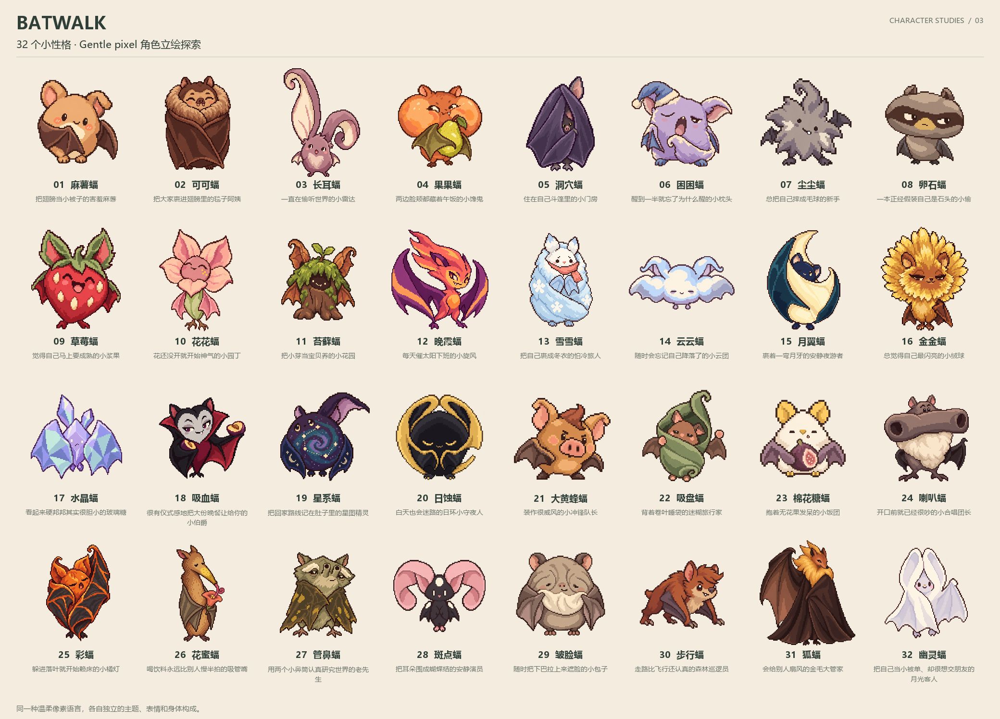

# Batwalk · 32 个小性格

**C · Gentle pixel** 统一温柔的像素画法。32 只蝙蝠分别设计自己的主题、面孔、身体构成、静态表情和性格，并从原有独特动作中提取形象线索。

## 查看与使用

- [32 张透明底原始立绘](portraits/)：按图鉴编号和稳定角色 ID 命名，保留生成原图及透明度。
- [六只代表角色](preview.png)：大黄蜂蝠、吸盘蝠、棉花糖蝠、苔藓蝠、月翼蝠和斑点蝠。
- [手表小尺寸预览](review-small-size.png)：每只以 64 px 在浅底和深底上对照展示；[单张缩小预览](review-64px/)。
- [角色清单](manifest.json)：编号、稳定 ID、中文工作名、角色设定、文件校验值与 102 个独特动作的对应关系。
- [完整生成提示词](prompts.json)：使用内置 image_gen；[检查记录](verification.json)。
- [逐只角色说明](README.txt)。

## 项目对应关系

名单对应 [PR #2](https://github.com/qianquandong/Batwalk/pull/2) 的 32 只蝙蝠，参考版本为 `ca4f65472e6167b281270c9f8b3ba8768c3d9141`。每只保留原有稳定 ID；中文名称为美术工作名。

这批保留原始角色立绘。32 张已缩小打包为游戏内静态角色；麻薯、吸盘、步行三只另有[首批逐帧动画](../pilots-v1/README.md)。其余角色的动作帧与专用 Shiny 调色板仍待制作。正式发布前还需真机尺寸与像素美术复核。

拟人化造型、道具和性格属于艺术创作；蝙蝠行为资料提供设计灵感。
