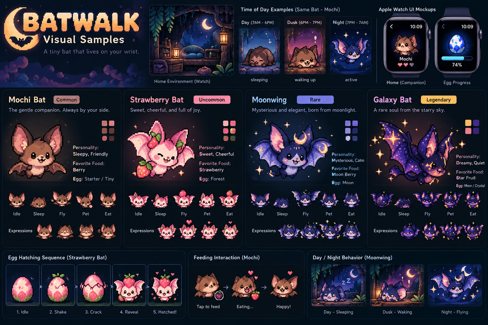

# Batwalk — Final Product Requirements Document

> **A tiny bat that lives on your wrist and grows when you move.**
>
> Batwalk turns everyday walking into a cozy collectible-pet loop on Apple Watch.
> The Watch is the game. The iPhone is the companion library and data viewer.

| Status | Primary platform | Language | Monetization |
|---|---|---|---|
| Final PRD v1.1 | Apple Watch | English only | Fully free; cosmetics later |

**Contents** — [Locked Decisions](#locked-product-decisions) · [1. Discovery](#1-discovery--problem--opportunity) · [2. Design](#2-design--solution-shape) · [3. Art Direction](#3-art-direction--production-spec) · [4. Build](#4-build--technical-implementation) · [5. Launch](#5-launch--deploy--operate) · [6. Content](#6-launch-content--20-bat-roster) · [7. Scope Lock](#7-mvp-scope-lock) · [8. Definition of Done](#8-mvp-definition-of-done)

> Where this document is ambiguous or self-contradictory, see [OPEN_QUESTIONS.md](OPEN_QUESTIONS.md) for how the code currently resolves it.

---

## Locked Product Decisions

| Area | Decision |
|---|---|
| Working title | Batwalk |
| Core platform | Apple Watch-first; iPhone companion is optional for core gameplay |
| Visual style | Gentle pixel: coarse readable 2D pixel characters, midnight teal, cream and sage (2026-10-10) |
| Mood | Cute + cozy + slightly mysterious; never horror-first |
| Launch roster | 20 bat species |
| Hatching cadence | Multi-day walks; no hard daily hatch cap |
| Duplicates | Allowed; duplicates add Friendship EXP to level up the owned bat instead of creating junk inventory copies |
| Companion | One current companion shown on Watch at a time |
| Naming | Players can rename their owned companion |
| Day/night | Based on local device time: Day / Dusk / Night |
| Feeding | Included; fruit rewards add interaction and Friendship. No hunger punishment. |
| Language | English only at launch |
| Pricing | Fully free launch; later purchases cosmetic only (2026-10-23) |
| Content access | All 20 launch bats and all five eggs are free; Oddballs stay wave 2 |
| Save | Local-first + iCloud/CloudKit backup/restore |
| Notifications | Only lightweight events such as Hatch Ready / Bat Awake |
| AI | **None.** No AI features, AI roadmap, or AI positioning |
| Punishment | No death, starvation, streak loss, guilt messaging, or level decay |

---

## 1. Discovery — Problem & Opportunity

### 1.1 Problem

Most activity products motivate users through steps, calories, streaks, rings, and goals. Those systems work for fitness-motivated users, but for casual users they often feel like another obligation.

At the same time, most virtual-pet games live on the phone and require deliberate sessions. Apple Watch creates a different opportunity: a tiny pet that is physically present on the wrist and reacts to the user's real-world movement.

> *"My egg is only 600 steps away from hatching."* is a stronger emotional prompt than *"I still need 600 steps today."*

### 1.2 Target Users

| User | Primary Goal | Constraint |
|---|---|---|
| Casual Apple Watch owner | Have a fun reason to move more | Does not want a serious fitness app |
| Cozy-game player | Care for a cute persistent companion | Short interaction windows |
| Collector | Find Rare, Legendary, and Shiny bats | Needs long-term collection goals |
| Existing fitness user | Add delight to normal walking | Does not want extra workout friction |

### 1.3 Core Pain Points

1. **Movement lacks emotional reward.** Raw numbers do not create attachment.
2. **Phone games require deliberate attention.** Batwalk should work in 3–10 second glances.
3. **Many Watch apps are reduced phone apps.** Batwalk is designed from the Watch outward.

### 1.4 Goals

- **Daily loop** — See bat → see progress → walk → return → receive a reward.
- **Movement becomes progression** — Steps directly affect egg hatching, collection, Friendship, and unlocks.
- **Emotional ownership** — The user should feel "this is my bat," not "this is a step counter skin."
- **Watch independence** — The core experience must remain playable without opening the iPhone app.

### 1.5 Non-goals for MVP

Deferred: GPS map, AR, trading, friends, guilds, leaderboards, battles, breeding, complex currency, subscriptions, energy systems, advanced habitat economy, weather-driven gameplay, real ambient-light detection.

---

## 2. Design — Solution Shape

### 2.1 Core Product

Batwalk is a Watch-first virtual-pet collection game. The user's real-world walking advances eggs, unlocks bats, and contributes to a light Friendship system. The iPhone companion app exists for deeper viewing, Batpedia, history, purchases, and recovery — not to gate the core loop.

```
WALK → EGG PROGRESS → ANTICIPATION → HATCH → COLLECT
  ↑                                              ↓
WALK AGAIN ← NEW EGG ← BUILD FRIENDSHIP ← CHOOSE CURRENT COMPANION
```

### 2.2 First-Time User Flow

1. Launch on Apple Watch.
2. Dark screen: "Something is sleeping in here..."
3. An egg appears.
4. Message: "Your steps help it hatch."
5. Show a dedicated **Enable Steps** screen, then ask for Step Count permission on Watch.
6. Verify a positive HealthKit reading before starting the first playable egg; credit today's steps through the normal ledger. Dismissal, query failure or zero readings keep a recoverable setup screen. Zero is not proof of denial: ask the player to enable Steps, walk a few steps and check again, with Watch Settings → Health → Apps → Batwalk instructions. Returning from Settings rechecks automatically. Existing zero-reading saves get the same recovery flow without replacing their egg. Players with previous step credit remain able to visit their bats on zero-step days.
7. Starter Egg target: 2,000 steps.
8. At 100%, Watch haptic + "Ready to hatch."
9. User turns the Digital Crown (or taps the egg) to crack it open, entirely on Watch; light in the rarity's colour leaks out before the reveal.
10. First bat joins Collection and becomes current companion.

### 2.3 Day / Dusk / Night

| Time State | Recommended Window | Bat Behavior |
|---|---|---|
| Day | 7:00 AM–6:00 PM | Sleeping, yawning, peeking, quiet interactions |
| Dusk | 6:00 PM–7:00 PM | Waking, stretching, opening one eye |
| Night | 7:00 PM–7:00 AM | Flying, playing, more energetic reactions |

> **Important:** Daytime is not a lockout. Day = companionship. Night = activity.

### 2.4 Watch Navigation

| Screen | Purpose |
|---|---|
| **Companion** | Current bat or first egg. The bat has the full activity area; tap it to pet/wake. Feed is the only visible control beside an owned companion. |
| **Egg** | Egg progress and remaining steps; hatch or choose the next egg. More opens device settings and offline collection tools. |

The Watch uses two vertically paged scenes. Give the companion the space freed by
removing its visible name and egg progress from the home scene. Keep a single
centered Feed button with a 44 pt touch target; swipe or turn the Digital Crown to
reach the egg page. Do not show friendship levels, level dots or action-unlock lists
on the Watch home. Its opening habit expresses the unlocked personality; explanations,
friendship details and manual action browsing belong on iPhone. Core play and
offline collection management remain available on Watch.

### 2.5 iPhone Companion MVP

- **Batpedia** — full-size bat art, species, rarity, hatch history, Friendship.
- **Collection** — owned, missing, Normal/Shiny status.
- **Large View** — presentation-quality bat view for screenshots.
- **Basic History** — hatch milestones and simple activity history.
- All launch content is free; purchase routes are dormant.

Habitat is deferred beyond MVP unless schedule permits.

### 2.5.1 Shareable memories (2026-10-23)

Journal rows open a 1200 × 1200 birth certificate with the existing portrait, nickname/species,
Batpedia number, hatch ordinal when known, rarity, original egg tier, estimated moon phase,
and real-bat fact. Shiny uses a static card with its **3% base** odds line; no video export.
Companion suggests the latest certificate once, with a dismiss control. Batpedia shares a
20-bat collection poster; Bat Detail keeps its existing card. All use Apple's share sheet.

Certificate start dates and completed target steps are recorded on Watch from this version
onward. Old records remain unavailable, never guessed. Days count local calendar boundaries,
minimum one. The phone-only “Show steps on shared cards” preference defaults on, but never
authorizes automatic transport: the player must tap “Include my steps and days” for a
specific certificate. That read-only response stays in memory. Off omits both values.

### 2.6 Egg System

| Egg | Target Steps | Purpose |
|---|---|---|
| Teaching Starter Egg | 2,000 | One-time first success |
| Starter / Tiny · 10K Egg | 10,000 | Themed everyday pools |
| Forest · Half Marathon Egg | 21,097 | Nature-themed pool |
| Moon · Marathon Egg | 42,195 | Night / Rare pool |
| Crystal · Ultra Egg | 100,000 | Higher-end Rare pool |

Egg progress accumulates across days. The longer eggs are multi-day goals; there is no daily hatch quota or reset.

**Free launch (Q1/Q13, 2026-10-23).** All five egg types are selectable. Each keeps its designed themed pool, including all enabled species without payment. Starter also remains the first onboarding egg. There is no trial egg or free-roster gate. Oddballs remain content wave 2.

### 2.7 Duplicate & Friendship System

Duplicates are allowed, but the Collection does not accumulate piles of identical copies. A duplicate converts into Friendship EXP for that species.

| Friendship Level | Unlock |
|---|---|
| Lv.1 | Base animation set |
| Lv.2 | Additional idle animation |
| Lv.3 | New interaction reaction |
| Lv.4 | Special signature animation |
| Lv.5 | Friendship badge + special expression/accessory |

**Simple duplicate rewards (2026-10-23).** Repeat hatches grant that species' normal rarity-based Friendship EXP and raise its level using the existing Lv.1–5 thresholds. At max level the cumulative EXP is kept. New hatches no longer award Moon Dust; do not add gifts, story chapters, invitations, or another currency. Legacy Moon Dust balances and redemption stay available only to players who already have a balance.

**Walk milestones (2026-10-23).** Starter and Tiny are 10,000 steps; Forest is 21,097, Moon 42,195, and Crystal 100,000. The one-time teaching Starter stays at 2,000 steps. Targets are stored when an egg starts. Existing eggs keep their previous target and credited steps, including eggs already ready to hatch. Progress accumulates across days.

The species-specific actions behind Lv.2–5 are listed in [`BAT_ACTIONS.md`](BAT_ACTIONS.md).

### 2.8 Feeding

Walking can occasionally yield simple fruit rewards such as berries or strawberries. Feeding produces a short reaction and contributes modest Friendship progress.

**No hunger system.** A bat never dies, starves, loses levels, or punishes the player for taking a break.

### 2.9 Shiny System

Every species can have a Normal and Shiny variant. Shiny is a palette/visual variant, not a separate species entry.

Example: Moonwing → Normal ✅ / Shiny ⬜. Twenty species therefore create up to forty meaningful visual collection targets.

Shiny must be reachable for those targets to mean anything: 3 % per hatch, a
guaranteed Shiny at least every 40 hatches, and ×3 odds for a species already at Lv.5
(Q14, 2026-10-10). The outcome is sealed when the egg is created.

### 2.10 Monetization

Launch is fully free. Paid content later is cosmetic only (habitats, costumes, egg shells, Nest). Never sold: steps, speed, odds, eggs, Friendship.

All five eggs, the full enabled roster, Shiny, and every Friendship level are available without an entitlement. `SharedConfig.paidContentEnabled` is false. `GameState.isUnlocked`, `EntitlementPolicy`, and `PurchaseManager` remain compatible but dormant. The legacy Full Unlock product is not offered by this version; see RELEASE_READINESS for its existing App Store Connect status.

---

## 3. Art Direction & Production Spec

> **Current visual direction — 2026-10-10.** The owner selected **C · Gentle pixel** in the redesign comparison. The active art and interface now use coarse readable pixel silhouettes, warm cream/earth colors, midnight teal surfaces, sage actions, and a sparse still glade. See [the current art specification](../Art/gentle-pixel/README.md). The earlier board below is retained as historical concept material.
>
> 

### 3.1 Visual Language

- **Style:** Gentle pixel: clear 32–48 px character silhouettes on a fixed 64 px logical canvas; nearest-neighbor rendering, restrained detail, deliberate Normal/Shiny palettes.
- **Shape language:** round bodies, readable ears, oversized expressive eyes, clear wing silhouettes.
- **Mood:** quiet midnight teal, warm cream, sage, peach, earthy characters; a few still pixel plants/stars. Keep UI surfaces flat and typography native/readable.
- **Avoid:** gore, realistic bats, horror imagery, overly childish preschool styling.
- **Priority:** character readability on a small Watch display.

### 3.2 Character Production Standard

Each launch bat should include, at minimum:

| Asset | Required | Notes |
|---|---|---|
| Idle | Yes | Primary loop animation |
| Sleep | Yes | Daytime identity |
| Wake / Drowsy | Yes | Day-to-night personality |
| Fly | Yes | Night active state |
| Pet reaction | Yes | Short touch feedback |
| Eat | Yes | Feeding interaction |
| Happy | Yes | Friendship / reward response |
| Hatch reveal | Yes | High-value emotional moment |
| Shiny palette | Yes | Same silhouette; distinct colorway |

### 3.3 Rarity Visual Rules

| Rarity | Direction |
|---|---|
| Common | Earthy, simple, warm, immediately lovable |
| Uncommon | More decorative palettes and thematic props |
| Rare | Clear magical motifs and distinct palettes; restrained reveal accents |
| Legendary | Distinctive palette, premium animation, strong "reveal" moment |

### 3.4 Watch UI Art Rules

- The bat or egg must visually dominate the screen.
- Progress numbers stay secondary.
- Avoid dense dashboard layouts.
- Key art must remain readable at actual Watch size.
- Animations should be short, expressive, and battery-conscious.

### 3.5 Egg Animation States

| Progress | Visual State |
|---|---|
| 0–25% | Calm / still |
| 25–50% | Occasional small shake |
| 50–75% | Visible cracks |
| 75–99% | Frequent movement / stronger crack state |
| 100% | Hatch-ready state + haptic; the player cracks it open with the Digital Crown or taps, light leaking out in the rarity's colour |

### 3.6 Pixel Artist Deliverables

- Transparent PNG sprite sheets.
- Consistent logical canvas size for all bats.
- Frame-aligned animation sheets with deterministic naming.
- Normal and Shiny palettes documented per species.
- Export previews at actual Apple Watch scale for visual QA.
- Source files preserved in layered/editable format used by the artist.

---

## 4. Build — Technical Implementation

### 4.1 Stack

| Layer | Choice | Purpose |
|---|---|---|
| Watch UI | SwiftUI | Native Watch experience |
| iPhone UI | SwiftUI | Shared Apple-native stack |
| Activity data | HealthKit | Read Step Count required for progress |
| Local persistence | SwiftData | Collection, egg state, names, Friendship, preferences |
| Backup / restore | iCloud / CloudKit | Prevent collection loss across device changes |
| Complication | WidgetKit | Persistent Watch-face presence |
| Phone sync | WatchConnectivity | Best-effort paired-device synchronization |
| Backend | None for MVP | Keep core loop local-first and low-cost |
| AI | None | Explicit product decision |

### 4.2 Architecture

```
APPLE WATCH
    │
    ▼
HealthKit Step Count
    │
    ▼
Local Game Engine
 ┌──────┬───────┬────────┐
 │Hatch │ Care  │ Time   │
 │Logic │ Logic │ State  │
 └──────┴───────┴────────┘
    │
    ▼
SwiftData
 ┌───────────────┬────────────────┐
 ▼               ▼
Watch App      WidgetKit
    │
    │ optional paired sync
    ▼
WatchConnectivity
    │
    ▼
iPhone Companion
    │
    ▼
CloudKit backup / restore
```

### 4.3 Game State

Minimum states: `egg`, `hatchReady`, `sleeping`, `drowsy`, `awake`, `happy`, `eating`, `playing`.

### 4.4 Hatch Logic

**Inputs:** egg type, required steps, current credited steps, local time state, existing collection, RNG seed.
**Outputs:** species ID, rarity, Normal/Shiny flag, hatch timestamp, credited steps.

| Example rarity | Initial target probability |
|---|---|
| Common | 65% |
| Uncommon | 25% |
| Rare | 8% |
| Legendary | 1.5% |
| Shiny modifier | 3% per hatch; guaranteed within 40 hatches; ×3 for a Lv.5 species (2026-10-10) |

Exact rates are tuning values for beta and may change without changing the core design.

### 4.5 Data & Privacy

- Read only the Health data required for the mechanic: Step Count.
- Step history, totals, active egg progress and certificate walk metrics never enter default mirrors, collection backups, analytics or links.
- The only certificate transfer is the player's explicit, single-receipt request; the phone keeps it in memory and the player chooses whether to share the rendered card.
- Do not upload raw step history to a custom server in MVP.
- Store game-derived state locally and in CloudKit backup.
- Analytics should record game events — not detailed Health history.

### 4.6 Analytics Events

Recommended minimum events: `onboarding_complete`, `step_permission_result`, `first_hatch`, `egg_complete`, `bat_collected`, `duplicate_friendship`, `companion_changed`, `feed_bat`, `purchase_unlock`, `restore_purchase`.

### 4.7 Performance & Battery Requirements

- No continuous GPS.
- No permanent Workout Session for the game loop.
- No second-by-second background step polling.
- Foreground actions should feel immediate.
- Open-to-visible-bat target: under ~1 second on supported devices.
- Hatch animation target: 2–4 seconds.

### 4.8 Platform Support

Target the current and previous major watchOS generation at development start, subject to real-device animation and performance testing. Do not sacrifice the core visual experience solely to support much older Watch hardware.

### 4.9 Critical Test Cases

- [ ] 0 → threshold hatch progression
- [ ] Large step jump between app launches
- [ ] Midnight rollover
- [ ] Time-zone and DST changes
- [ ] Watch restart / force quit
- [ ] Health permission denied or later revoked
- [ ] Phone unavailable
- [ ] Cloud restore to a new device
- [ ] Duplicate bat correctly adds Friendship
- [ ] Normal/Shiny collection flags remain correct
- [ ] Purchase and Restore Purchase survive reinstall

See [TEST_PLAN.md](TEST_PLAN.md) for which of these are covered by unit tests and which need a real device.

---

## 5. Launch — Deploy & Operate

### 5.1 Launch Plan

| Phase | Audience | Goal | Exit Criteria |
|---|---|---|---|
| Alpha | 10–20 testers | Prove the loop feels delightful | ≥80% first-hatch completion; no critical save bugs |
| Closed Beta | 50–100 Apple Watch users | Validate retention and walking motivation | D7 ~25–30%+; Health permission ≥70%; stable battery feedback |
| GA | Global App Store, English-only | Test retention and walking motivation | Crash-free >99.5%; core KPIs stable |

### 5.2 North Star

| Target | Metric |
|---|---|
| **≥4** | Active Bat Days / WAU / week — a day counts when the user has real progress *and* interacts with the bat |
| **≥70%** | First hatch within 24h |
| **≥30%** | D7 retention target |

### 5.3 Supporting Metrics

| Metric | Target |
|---|---|
| Step permission completion | ≥75% |
| D1 retention | ≥50% |
| Watch opens per active day | ≥3 |
| Bats collected in first week | ≥3 |
| Complication adoption | ≥20% (portrait + egg ring; Smart Stack at hatch-ready and dusk) |
| Crash-free sessions | >99.5% |

### 5.4 Key Risks

| Risk | Mitigation |
|---|---|
| Novelty wears off | Collection depth, rarity, Friendship, Shiny variants, seasonal content, and later evolution. |
| Watch gameplay feels shallow | Keep Watch interaction short and emotionally rich; use iPhone for deeper viewing instead of stuffing menus onto Watch. |
| Battery complaints | Avoid continuous sensors, GPS, excessive background refresh, and long animations. |
| Permission refusal | Explain the benefit clearly: "Your steps hatch your bat." Provide a graceful non-progress state if permission is denied. |

---

## 6. Launch Content — 20 Bat Roster

| # | Bat | Rarity | Personality / Visual Hook | Primary Egg |
|---|---|---|---|---|
| 1 | Mochi Bat | Common | Round, sleepy, friendly starter mascot | Starter / Tiny |
| 2 | Cocoa Bat | Common | Chocolate brown, calm, wraps in wings | Tiny |
| 3 | Long Ear Bat | Common | Oversized ears, curious reactions | Tiny / Forest |
| 4 | Fruit Bat | Common | Round face, food-loving | Forest |
| 5 | Cave Bat | Common | Shy, hides in wings | Tiny / Forest |
| 6 | Sleepy Bat | Common | Half-closed eyes, tiny sleep cap | Tiny |
| 7 | Dust Bat | Common | Fluffy gray, clumsy flight | Forest |
| 8 | Pebble Bat | Common | Stone-like round sleeper | Tiny |
| 9 | Strawberry Bat | Uncommon | Pink/red, strawberry motif, cheerful | Forest |
| 10 | Blossom Bat | Uncommon | Soft pink, petal particles | Forest |
| 11 | Moss Bat | Uncommon | Green/brown, tiny sprout | Forest |
| 12 | Sunset Bat | Uncommon | Orange/purple, energetic at dusk | Forest / Moon |
| 13 | Snow Bat | Uncommon | White/blue, snowflake particles | Crystal |
| 14 | Cloud Bat | Uncommon | Fluffy white-gray, dreamy | Crystal |
| 15 | Moonwing | Rare | Deep blue, moon motifs, mysterious | Moon |
| 16 | Golden Bat | Rare | Gold accents, confident sparkle | Crystal |
| 17 | Crystal Bat | Rare | Blue/purple crystalline wings | Crystal |
| 18 | Vampire Bat | Rare | Cute black/red cape, dramatic not scary | Moon |
| 19 | Galaxy Bat | Legendary | Starfield body, premium particles | Moon / Crystal |
| 20 | Eclipse Bat | Legendary | Black/gold halo, silent and rare | Special / Moon |

### 6.1 Free Launch Species

All 20 launch species and all five egg types are free. Pool themes, rarity odds, sealed outcomes and pity rules stay intact. The 12 Oddballs are a content-wave update, never a paid roster tier.

### 6.2 Current Companion Naming

Species identity remains fixed, but the player can give the owned companion a personal name. Example: Species = Moonwing, Player Name = Luna. The personal name appears in collection and iPhone detail; the quiet Watch home shows only the bat and Feed.

### 6.3 Oddball Bats (roster expansion, #21–32)

Twelve extra species, each a cute Batwalk take on a **real, genuinely strange bat**.
They keep the cozy art rules (§3): the real animal is only the hook — round body,
big eyes, never realistic or scary. Batpedia shows each one's *Real-life Cousin*
as a one-line fun fact. All are free when their content wave is enabled.

| # | Bat | Rarity | Personality / Visual Hook | Primary Egg | Real-life Cousin |
|---|---|---|---|---|---|
| 21 | Bumblebee Bat | Common | Thumb-sized, piggy nose, buzzes when it flies | Tiny | Kitti's hog-nosed bat (~2 g) |
| 22 | Sticky Bat | Common | Suction-cup thumbs, naps head-up in a rolled leaf | Tiny | Spix's disk-winged bat |
| 23 | Marshmallow Bat | Uncommon | Snow-white puff, yellow nose/ears, sleeps in a leaf tent | Forest | Honduran white bat |
| 24 | Honk Bat | Uncommon | Big goofy snout, honks when happy | Forest | Hammer-headed bat |
| 25 | Ember Bat | Uncommon | Bright orange, black-trimmed wings, hides in dry leaves | Forest | Painted bat |
| 26 | Nectar Bat | Uncommon | Super-long tongue, blep, always sipping flowers | Forest | Tube-lipped nectar bat |
| 27 | Tube-Nose Bat | Uncommon | Snorkel nostrils, speckled wings, wise old face | Moon | Tube-nosed fruit bat |
| 28 | Polka Bat | Rare | Black with three white spots, gigantic pink ears | Moon | Spotted bat |
| 29 | Wrinkle Bat | Rare | Squishy wrinkly face, hides behind a fluffy chin mask when shy | Moon | Wrinkle-faced bat |
| 30 | Walker Bat | Rare | Folds its wings and power-walks everywhere — the game's spirit animal | Crystal | NZ lesser short-tailed bat |
| 31 | Fox Bat | Rare | Huge cloak-like wings, fox face, golden crown of fur | Crystal | Giant golden-crowned flying fox |
| 32 | Ghost Bat | Legendary | Pale glow, see-through wings, gentle never spooky | Crystal | Australian ghost bat |

Forest stays Common + Uncommon only, so per-egg rarity odds (§4.4) are unchanged;
each rarity simply has more species to find. With Shiny variants the Batpedia
grows from 40 to 64 collection targets. They ship as the **first content update
(v1.1)**, not at launch (Q12, decided 2026-10-10): `BATWALK_CONTENT_WAVE` gates
them, so launch animation work stays on the 20-bat roster and the update gives
the App Store a second moment.

---

## 7. MVP Scope Lock

### 7.1 Must Have

- [ ] Apple Watch main game
- [ ] HealthKit Step Count progression
- [ ] Egg progress states and hatch animation
- [ ] 20 launch bats
- [ ] Normal + Shiny collection state
- [ ] Duplicate → Friendship EXP
- [ ] Current companion selection
- [ ] Custom naming
- [ ] Feed / Pet / Wake interactions
- [ ] Day / Dusk / Night behavior
- [ ] Watch complication
- [ ] SwiftData local save
- [ ] CloudKit backup / restore
- [ ] iPhone Batpedia / Collection / Basic History
- [x] Fully free launch; dormant purchase plumbing reserved for future cosmetic content
- [ ] English-only launch copy

### 7.2 Explicitly Deferred

Habitat economy, evolution, moon-phase events, weather events, social, trading, challenges, breeding, GPS exploration, AR, battle systems, subscriptions, AI, real ambient-light detection.

---

## 8. MVP Definition of Done

A user can leave the iPhone behind, walk with Apple Watch, reach an egg threshold, return to the Watch, hatch a bat, save it into the Collection, interact with it, and begin another egg — **without needing the phone.**

### Emotional Definition of Done

The product is not done merely because the mechanic works. At least these moments must feel delightful on real hardware:

1. First egg appears.
2. Egg moves for the first time.
3. Egg cracks.
4. Watch gives the hatch-ready haptic.
5. Rare/Legendary reveal feels special.
6. A duplicate feels useful because Friendship increases.
7. The player sees the bat sleeping in the morning.
8. The same bat wakes and becomes active at dusk/night.

> **Core validation question:** Does this loop make users want to walk a little more and check their wrist because they care about what happens to the bat? If yes, Batwalk has product-market potential. If no, adding more systems will not fix the core experience.

---

*Batwalk PRD v1.0 — consolidated from approved product decisions and the approved visual concept board. Working title and tuning values may evolve during testing; the core Watch-first, non-AI, cozy collectible-pet direction is locked for MVP.*
