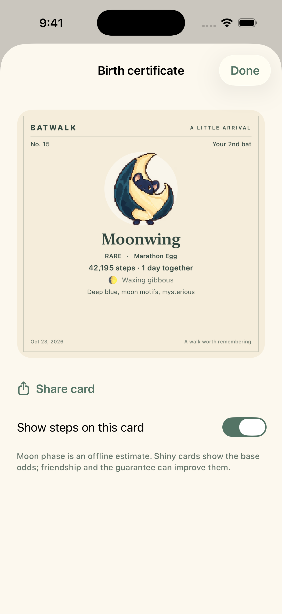
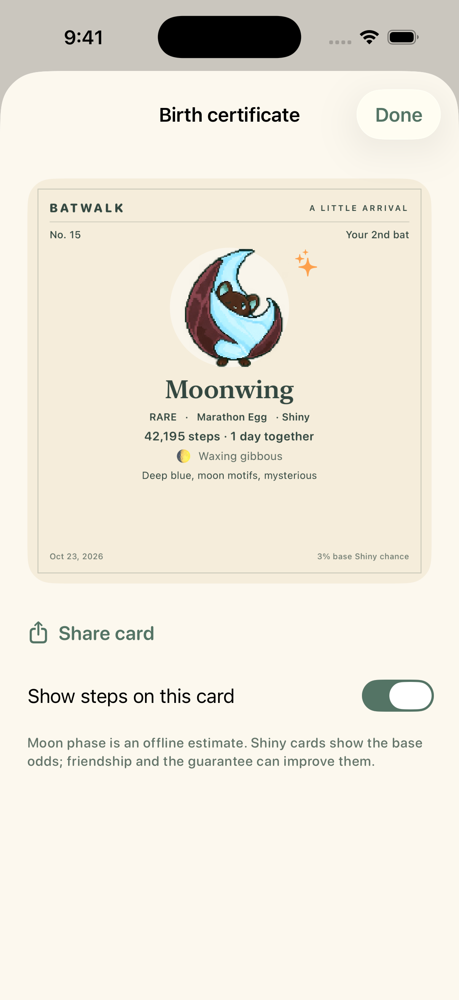
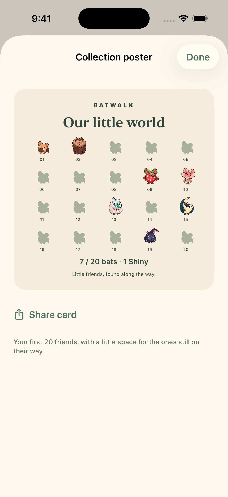
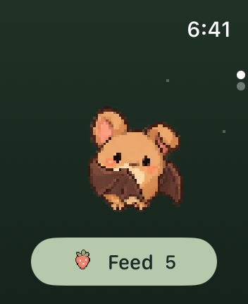
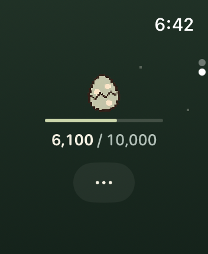
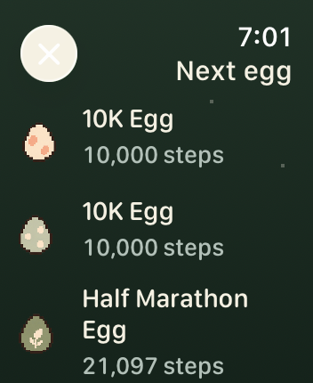

# Birth certificates and collection sharing · 2026-10-23

- New iPhone scenarios: `phone-certificate`, `phone-certificate-shiny`, `phone-poster`.
- Fixed 400 pt cards render with ImageRenderer scale 3 to 1200 × 1200. Existing Gentle pixel portraits remain unchanged.
- Static Shiny certificate shipped; no reveal video. The odds line reads the base chance from Tuning (currently **3%**) because friendship and pity may improve it.
- Core: tolerant old receipts, local calendar days, offline approximate eight-phase MoonPhase, new egg milestones with existing targets preserved.
- Privacy: ordinary mirrors and collection backups omit step accounting and private certificate metrics. A dedicated per-certificate action requests only that receipt from Watch, held in memory; it never changes the game or queues a background transfer.
- The initial show-steps preference does not request anything. Old data stays visibly unavailable instead of inventing dates.
- On upgrade, still-outstanding mirror files with old private payloads are cancelled before the current collection is sent. Failure retries are redacted again. Data already delivered by the system cannot be recalled; old phone archive copies are redacted locally.

## Verification and screenshot provenance

127 Linux core tests passed after receipt, redaction, moon-phase and milestone changes. All app Swift sources pass a parser check. Hosted tests check that birth certificates and the collection poster export nonempty 1200 × 1200 images, and that old phone caches are redacted in both rotating copies.

[CI at `4392b3d`](https://github.com/qianquandong/Batwalk/actions/runs/39915220021) completed all validation steps: 127 core tests, 41 hosted app tests, release-script/art checks, Watch and iPhone simulator builds, and capability-enabled unsigned build. The later legacy-transfer privacy fix adds one more hosted test and is covered by the latest PR checks before merge.

The Screenshots workflow captures both devices with `launch_roster=true`. Screenshots do not establish real-device HealthKit, energy or touch validation.

- [Full capture](https://github.com/qianquandong/Batwalk/actions/runs/39912694008), source `48adacc21ac43cd6a1c6a7a73371fa93ef5e9abe`: 29 Watch and 17 iPhone scenarios. The unchanged Watch home and egg-progress images below come from this run.
- [Final visual capture](https://github.com/qianquandong/Batwalk/actions/runs/39914632147), source `68f1830e8fc9d8993142ef8bfdaf67784b879889`: small Watch egg picker and all 17 iPhone scenarios. It includes the readable multiline egg names and the collection-poster export fix. Subsequent changes bind the unchanged odds label to Tuning and harden legacy sync; they do not change these layouts.
- Visually inspected normal/Shiny certificates, poster, phone Settings and Companion, Watch home, progress and egg picker. All three new cards show a Share card action. The poster uses eager rows so off-screen ImageRenderer exports materialize every portrait.
- Original selected PNGs and SHA-256 hashes: [manifest.json](manifest.json). Remaining captures are in the workflow artifacts. The Debug-only Animation samples row is absent from release builds.

| Normal certificate | Static Shiny certificate | Collection poster |
|---|---|---|
|  |  |  |

| Watch companion | Watch egg progress | Watch egg choices |
|---|---|---|
|  |  |  |

Moon estimate reference: [NASA mean synodic month](https://eclipse.gsfc.nasa.gov/phase/phases0001.html) and [NASA phase tables](https://ntrs.nasa.gov/api/citations/19950008253/downloads/19950008253.pdf). This is decorative, offline, and can differ near phase boundaries.
