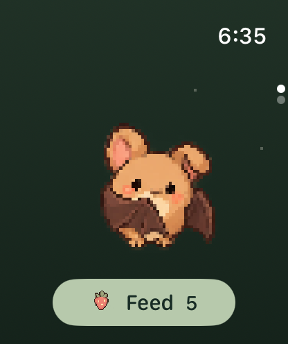
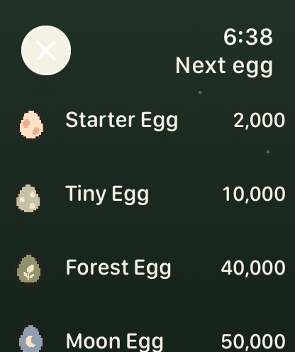
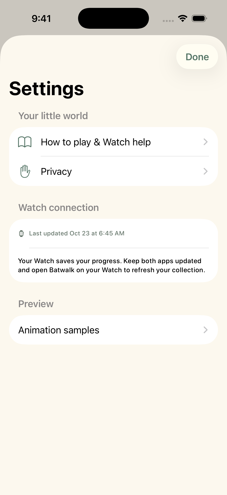
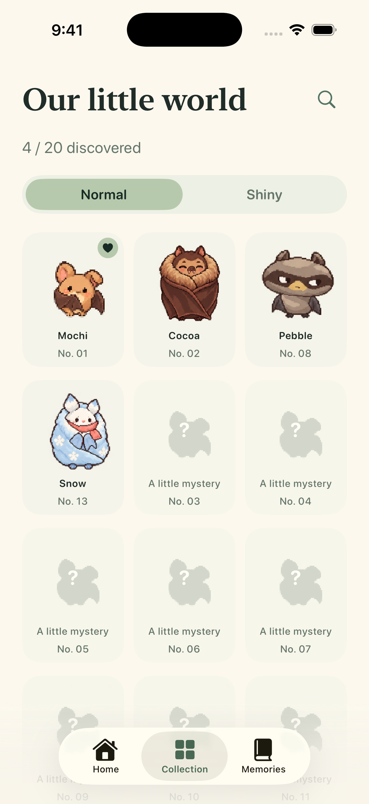

# Free launch · 2026-10-23

All five eggs and the 20 launch bats are free. Pools stay themed and wave 2 stays disabled. The quiet Watch companion scene and original Gentle pixel artwork are unchanged. The approved inset egg page and iPhone redesign are retained.

## Review scenarios

- Watch `egg-picker`: every egg can be selected, without an unlock message.
- iPhone `phone-settings`: help, privacy and connection; no purchase entry.
- iPhone `phone-batpedia` / `phone-batpedia-rare`: missing bats remain discovery silhouettes, with no paid lock action or completed-free-tier card.
- Existing home, egg progress, hatch, care, handoff, empty and accessibility scenarios are captured on both devices.

## Verification and provenance

The Screenshots workflow must run with `launch_roster=true`, both devices enabled, artifact output only. Screenshots are original simulator outputs and do not establish real-device HealthKit, energy or touch validation.

Core tests cover equal pools and Shiny outcomes without entitlement, every egg selectable, no trial gating, unchanged pity, legacy sealed/unsealed outcome migration and save compatibility. Hosted tests verify disabled purchase operations make zero backend calls.

Source commit: `920895b3242748c6aea715af4d95f1d852b1f34b`.

- [CI](https://github.com/qianquandong/Batwalk/actions/runs/39911941462) passed: 120 Linux core tests, 39 hosted app tests, release-script/art checks, Watch + iPhone simulator builds, capability-enabled unsigned build.
- [Screenshots](https://github.com/qianquandong/Batwalk/actions/runs/39911940378) passed: 29 Watch and 14 iPhone scenarios, `launch_roster=true`, no output-branch publishing.
- Visually inspected Watch home and egg picker, iPhone settings and collection. Settings shows no purchase route, the collection uses discovery silhouettes, and the Watch retains its bat + Feed scene. The egg picker scrolls to all five choices.
- Original selected PNGs and SHA-256 hashes: [manifest.json](manifest.json). Remaining captures are in the workflow artifact. The Debug-only Animation samples row is absent from release builds.

| Watch home | Watch eggs | iPhone settings | iPhone collection |
|---|---|---|---|
|  |  |  |  |

No App Store submission is part of this PR.
