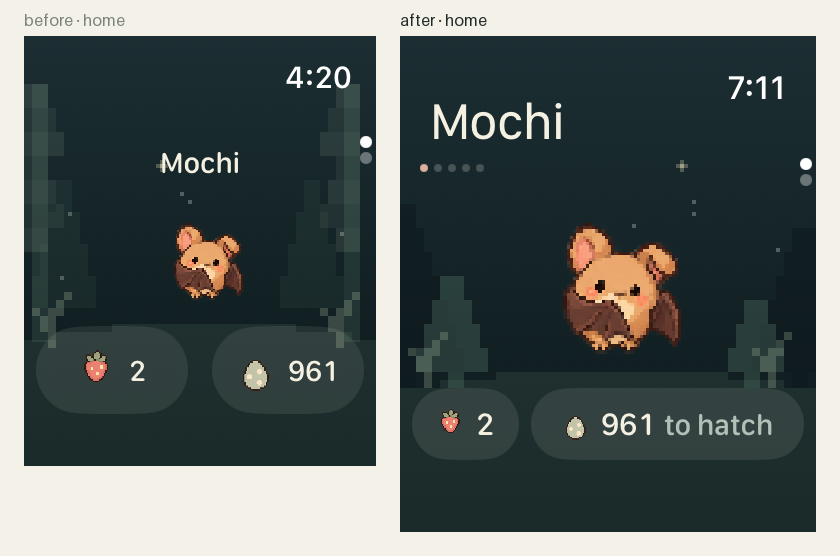
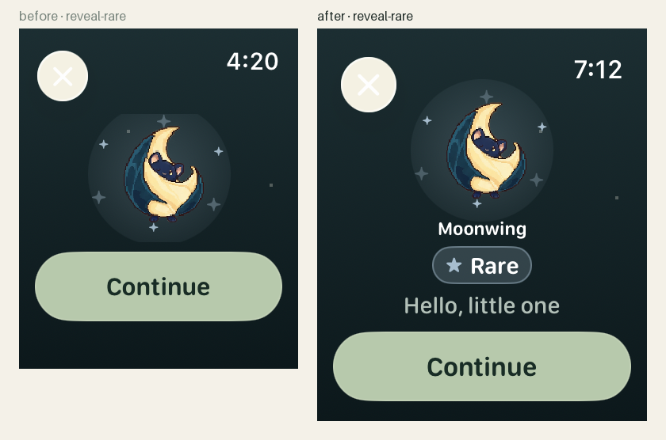
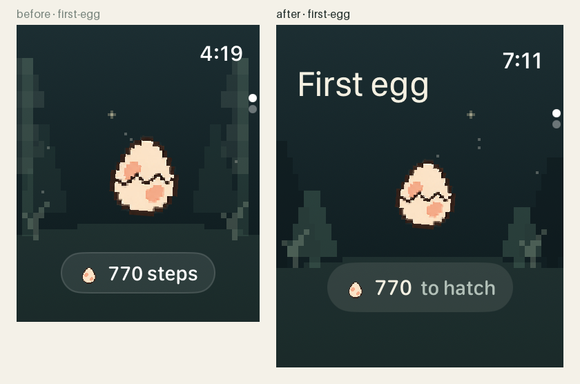
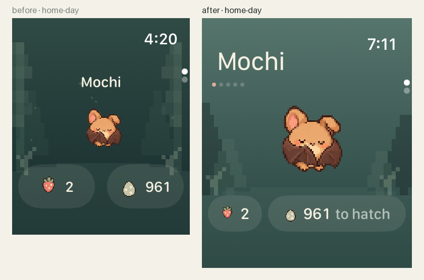
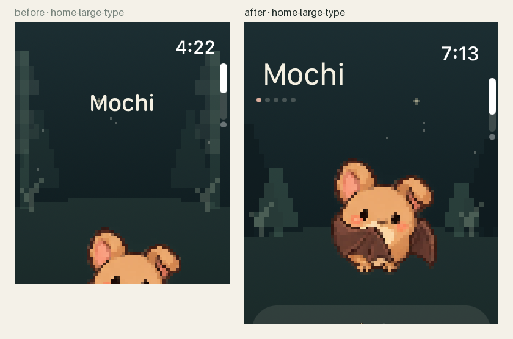
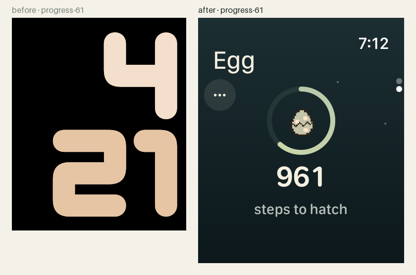
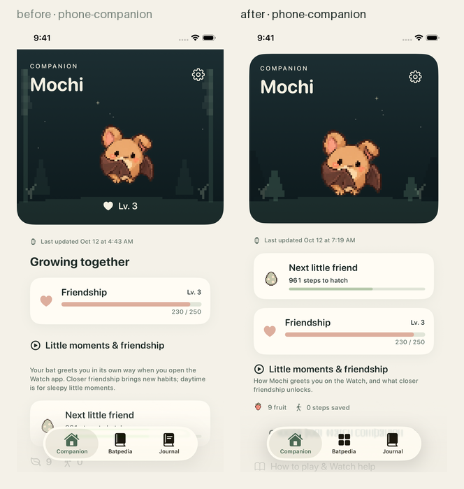
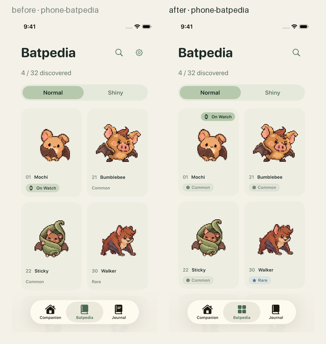
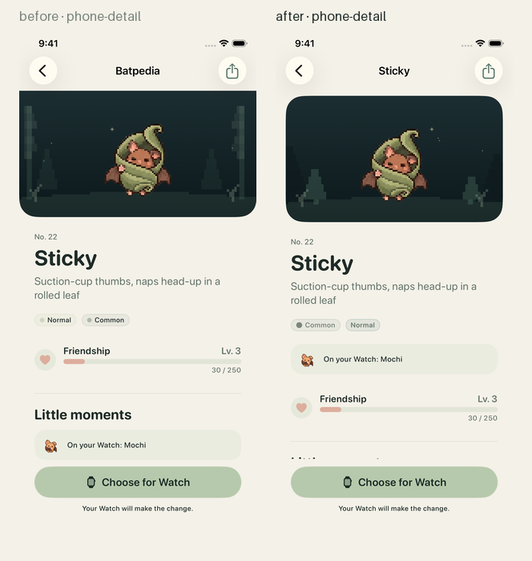
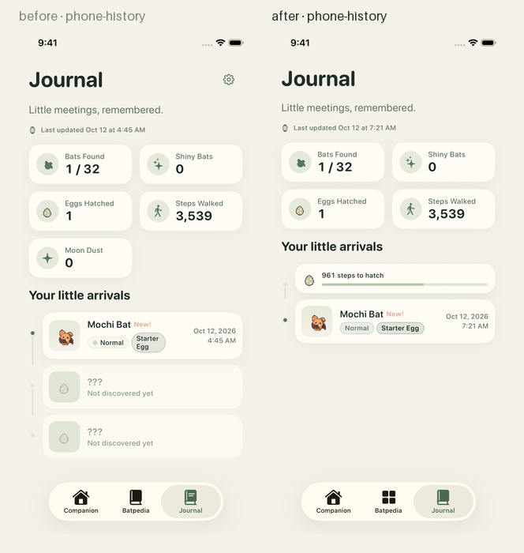

# Quiet UI polish · 2026-10-12 · 实际截图

在 [quiet-watch-2026-10-11](../quiet-watch-2026-10-11/README.md) 的精简界面之上做的一轮设计修正（PR #6，叠在 #5 上）。
角色、图标、色板不变；改的是层级、信息和几处工程瑕疵。模拟器原始截图 **23 张 Watch、14 张 iPhone**，
另有 13 组"改前 / 改后"对比图（左 = 10-11 版，右 = 本版）。

## 改了什么

**Watch**
- 首页：名字进系统标题位（和时间齐平），亲密度五点在其下方；蝙蝠占满剩余空间；底部压成一条 36 pt 信息行，
  "961 to hatch" 带语义；大字号改为自然滚动，蝙蝠不再被挤出屏幕。
- 揭晓页：名字 + 稀有度芯片进固定布局，不再只有一只蝙蝠和 Continue。
- 天空按时段变色（正午无星），松树改为阶梯剪影；星星避开标题和亲密度点。
- 蛋页：标题 "Egg"，"…" 按钮改为场景内按钮（见下方"崩溃"）。

**iPhone**
- Companion / 详情页的 hero 改为内嵌圆角卡片，不再在深色块上方留一条奶油色状态栏带；蛋进度卡提到亲密度卡前；
  hero 不再重复 Lv.；口袋行（水果 / 存步）带标签。
- 稀有度芯片在浅色面上用深一级墨色；Batpedia 卡片始终显示稀有度，"On Watch" 改成角标。
- Tab 图标三种各异；齿轮只留在 Companion；Journal 去掉 "???" 占位，用"在路上的蛋"做唯一前瞻条目，
  Moon Dust 有了才显示；购买页的感谢语只在购买后出现；删除未被引用的 `StatsView.swift`。

## 10-11 版四张表盘截图的原因

`progress-61`、`progress-100`、`settings`、`health-error` 之前截到的是系统表盘，不是截图流程的问题：
watchOS 26 模拟器上，页面顶栏里有 `ToolbarItem` 时，页面出现即触发 `-[UINavigationBar layoutSubviews]`
的 NSAssertion，进程 SIGABRT。`scripts/capture-screens.sh` 现在会在应用不在前台时打印模拟器日志和崩溃堆栈，
这就是定位依据。蛋页的 "…" 按钮移出顶栏后，23 个 Watch 场景全部截到应用本身。

## 对比图

| | |
| --- | --- |
|  |  |
|  |  |
|  |  |

| | |
| --- | --- |
|  |  |
|  |  |

其余：[compare/](compare/) · 原始文件：[Watch 23 张](screens/watch/) · [iPhone 14 张](screens/phone/)。

## 来源

- 截图运行：见 `manifest.json`（工作流运行、来源提交、产物名）。
- 所有 PNG 与 `screenshots-output` 分支上发布的产物逐字节一致，未修图。
- 静态截图不能代替真机上的动画节奏、震动和耗电验证。

截图中的角色和美术遵循仓库的 [CC BY-NC 4.0 美术许可](../../../Art/LICENSE)。
