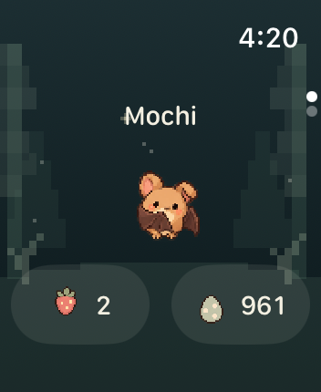
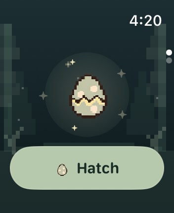
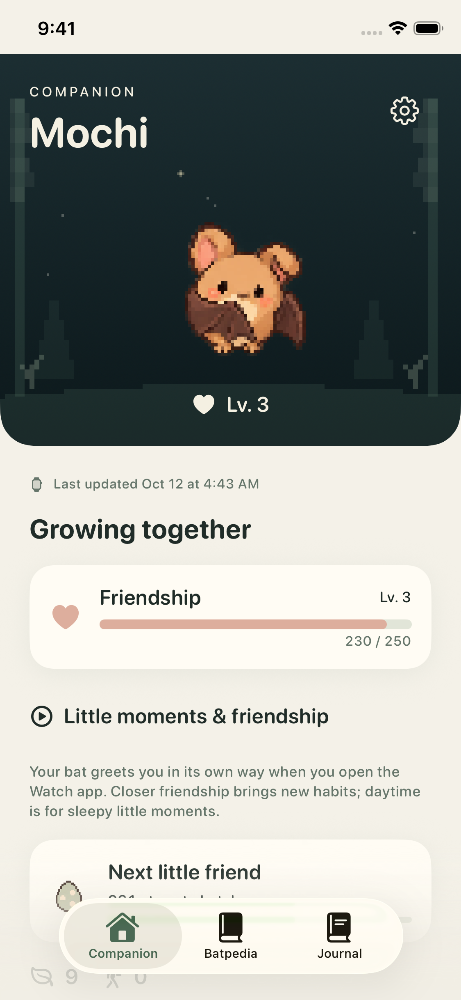
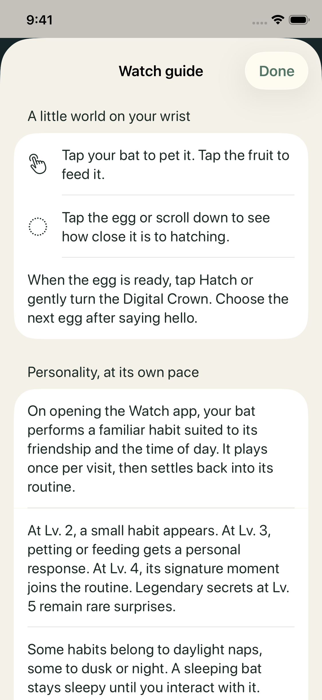

# Watch 精简界面 · 实际截图

本次界面修改的模拟器原始截图，共 **23 张 Watch、14 张 iPhone**。沿用已经确认的 Gentle pixel 角色和 C 版图标，没有重新设计蝙蝠。

Watch 保留陪伴与蛋两个主要页面；亲密度等级、解锁说明和动作回看放到 iPhone。打开 Watch 时，蝙蝠按亲密度和时间表演已解锁的小动作，每次访问一次。

## 当前效果

| Watch 首页 | 准备孵化 |
| --- | --- |
|  |  |

| iPhone 陪伴页 | iPhone 使用说明 |
| --- | --- |
|  |  |

## 还需要修正

- Watch 首页的蝙蝠偏小，底部按钮偏大；这批截图保留当前效果，尚未调整比例。
- `18-home-large-type.png` 中大字号布局把蝙蝠挤到屏幕底部，需要继续改善。
- Watch 的 `08-progress-61.png`、`09-progress-100.png`、`16-settings.png`、`17-health-error.png` 只截到了系统表盘，不能代表对应页面通过验证。保留原始文件用于排查，尚未确定是应用退出还是截图流程问题。
- 其余文件并未逐一完成视觉验收；静态截图也不能证明动画或实机交互完整通过。

## 全部原始文件与来源

- [Watch：23 张](screens/watch/)
- [iPhone：14 张](screens/phone/)
- [文件清单、尺寸、SHA-256 和检查状态](manifest.json)
- [截图运行记录](https://github.com/qianquandong/Batwalk/actions/runs/38202859075)，来源提交 `1f7b796`，产物 `batwalk-screenshots`。
- [UI 编译和测试通过记录](https://github.com/qianquandong/Batwalk/actions/runs/38203068159)：115 个核心测试、31 个应用测试，以及 Watch/iPhone 模拟器和启用 capabilities 的无签名构建。

全部 PNG 与下载的产物逐字节一致，未修图或替换失败画面。后续提交修正了离线图鉴导航和截图工作流；这里仍明确保留这批截图的原始提交来源。

本界面版本尚未上传 TestFlight，未提交 App Store 审核。当前 TestFlight 1.0 (16) 是此前的图标版本。

截图中的角色和美术遵循仓库的 [CC BY-NC 4.0 美术许可](../../../Art/LICENSE)。
