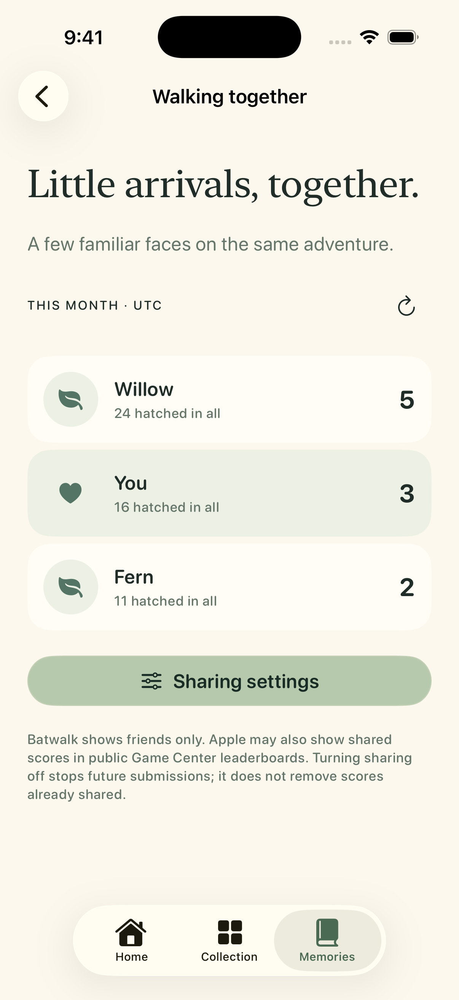

# Walking together — 2026-10-23

The iPhone Memories page links to Walking together. Monthly and all-time hatch
sharing have separate switches, both off by default. No step leaderboard exists.
The social month uses UTC; the personal outfit challenge uses local dates.

`phone-friends` uses three invented profiles (Willow, You, Fern), displays the
player's row distinctly, and has no rank numbers. The screenshot backend cannot
authenticate with or submit to Game Center. The existing Watch UI and bat art
remain the same; monthly accessories are inherited from the preceding PR.

## Provenance

- Initial native compile / hosted-test run: [CI 39913657743](https://github.com/qianquandong/Batwalk/actions/runs/39913657743), source `8028ddc`, all jobs passed including the Game Center capability-enabled build.
- Initial both-platform, launch-roster screenshot run: [Screenshots 39913660545](https://github.com/qianquandong/Batwalk/actions/runs/39913660545), source `8028ddc`, publish off.
- That screenshot workflow completed successfully. `phone-friends.png` is its
  original 1206 × 2622 simulator image; reviewed for complete copy, three rows,
  own-row highlight, UTC month label and visible sharing disclosure.
- This folder is completed with the final integrated screenshots and validation
  result before merging the friends PR. A running workflow is not a pass.

## Checks

Core tests cover actual calendar months, legacy-save counter migration and
history-trimmed backups. Fake-backend tests cover per-account consent, no work
while off, permission revocation, all friend pages, stale month contexts, and
late results after opting out. Native builds validate the real GameKit API.

Real account and signed-device tests remain separate: a simulator screenshot
does not establish friend authorization, successful score posting, or public
Game Center visibility. See [Game Center implementation and privacy](../../GAME_CENTER.md).

