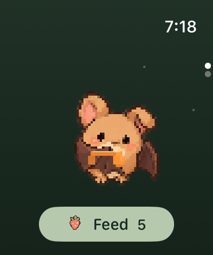

# Walking together — 2026-10-23

The iPhone Memories page links to Walking together. Monthly and all-time hatch
sharing have separate switches, both off by default. No step leaderboard exists.
The social month uses UTC; the personal outfit challenge uses local dates.

`phone-friends` uses three invented profiles (Willow, You, Fern), displays the
player's row distinctly, and has no rank numbers. The screenshot backend cannot
authenticate with or submit to Game Center. The existing Watch UI and bat art
remain the same; monthly accessories are inherited from the preceding PR.

## Provenance

- Initial native compile / hosted-test run: [CI 39913657743](https://github.com/qianquandong/Batwalk/actions/runs/39913657743), source `8028ddc`, all jobs passed including the Game Center capability-enabled build.
- Both-platform, launch-roster screenshot run: [Screenshots 39916161780](https://github.com/qianquandong/Batwalk/actions/runs/39916161780), source `eaa7069`, publish off, completed successfully. `watch-home.png` preserves its original 416 × 496 image of the quiet Watch companion page.
- Final iPhone capture: [Screenshots 39918370559](https://github.com/qianquandong/Batwalk/actions/runs/39918370559), source `8e0d407`, phone-only, completed successfully. Exact source files and hashes are recorded in `manifest.json`.
  Images are original simulator PNGs, reviewed for complete copy, three rows,
  own-row highlight, UTC month label and visible sharing disclosure.
- The final PR's CI check is authoritative for the integrated source, including
  birthday settings and privacy fixes. Cancelled superseded runs are not passes.

## Checks

Core tests cover actual calendar months, legacy-save counter migration and
history-trimmed backups. Fake-backend tests cover per-account consent, no work
while off, permission revocation, all friend pages, stale month contexts,
offline month rollover, and late results after opting out. The submission-order
regression blocks an old request while a new refresh arrives: the old code
finishes scores in the wrong order, while the serialized code preserves the
newest score. Native builds validate the real GameKit API.

Local integrated checks: 149 core tests; 12 coordinator fake-backend tests in the
Linux harness; 13 Python capability/archive tests. The harness exercises the
coordinator with platform stubs, not Apple's live Game Center. GitHub's native
hosted suite exercises the same tests with the real iPhone SDK.

Real account and signed-device tests remain separate: a simulator screenshot
does not establish friend authorization, successful score posting, or public
Game Center visibility. See [Game Center implementation and privacy](../../GAME_CENTER.md).

