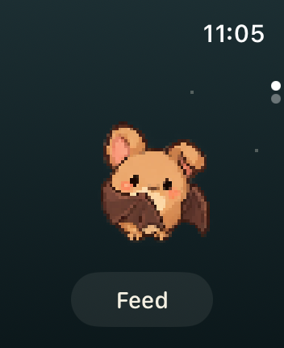
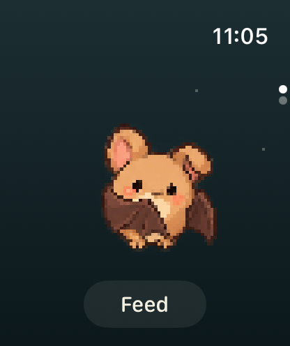
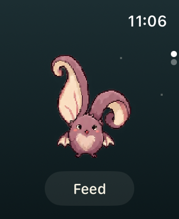
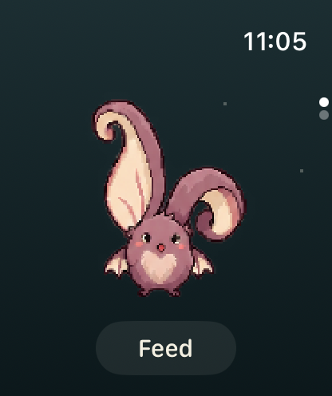
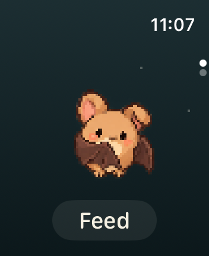

# Watch · Bat + Feed · 2026-10-12

根据对 build 17 首页的反馈调整：去掉角色名字和蛋进度入口，把空间交回蝙蝠，底部只保留 Feed。

- 原始角色、完整动作画布和自动小动作不变，角色等比例显示。
- 首页取消名字占用的标题行，并把活动区域延伸到原底部留白；Feed 仍有 44 pt 点击区域。
- 水果数量不占用画面，VoiceOver 仍能读到库存及无水果时的提示。
- 大字号使用同一简洁布局，Feed 留在当前画面。
- 蛋进度继续放在第二页，可滑动或转动表冠前往；iPhone 的 Watch guide 已同步说明。
- 本次调整针对已有蝙蝠的陪伴场景；首次孵化、准备孵化和揭晓流程未修改。

## 真实模拟器截图

| 41mm · 352 × 430 | 46mm · 416 × 496 |
| --- | --- |
|  |  |
|  |  |
|  |  |

保留的 PNG 均为未修改的模拟器输出，来源与哈希见 manifest.json。静态截图不代表完成了触摸、VoiceOver 或实机测试。

本次未合并 main 或更新 TestFlight；build 17 是此前的布局。

截图中的角色与美术遵循仓库的 [CC BY-NC 4.0 美术许可](../../../Art/LICENSE)。

## 验证

代码提交 `95f50b460782bf39867a65260314a7f73a7dd3a0`：

- [完整 CI](https://github.com/qianquandong/Batwalk/actions/runs/38319897568) 通过：Watch 和 iPhone 编译、115 项核心测试、31 项应用测试、8 项脚本测试，以及启用 capabilities 的无签名构建。
- [41mm 截图](https://github.com/qianquandong/Batwalk/actions/runs/38319905068)和 [46mm 截图](https://github.com/qianquandong/Batwalk/actions/runs/38319907722)任务成功，各输出 26 张图；本目录各保留 7 张与陪伴首页相关的截图。
- 已查看普通首页、小屏昼夜、可可蝠、长耳蝠、无水果状态、大字号和大屏步行蝠等代表场景，具体清单见 [manifest.json](manifest.json)。
