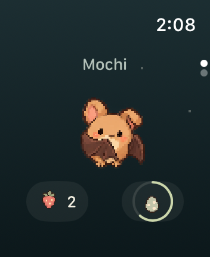
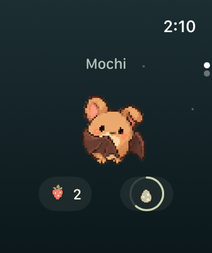
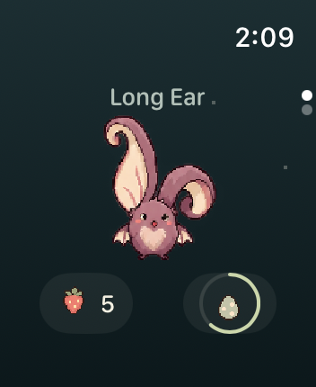
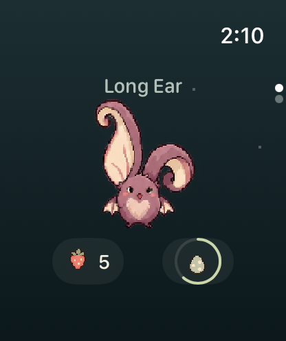
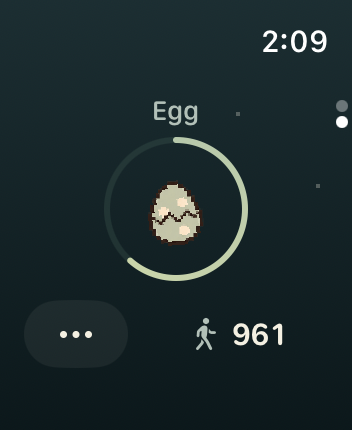
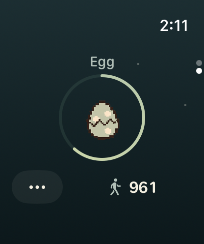
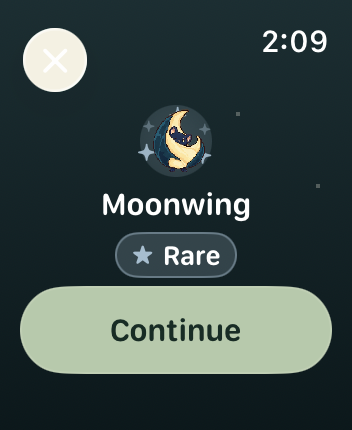
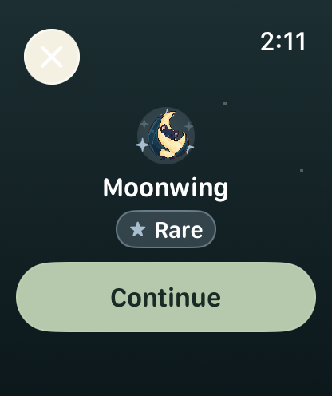

# Watch 宠物场景 · 2026-10-12

在 Claude 的 PR #6 基础上继续调整。现有蝙蝠素材、动画、自动问候和亲密度规则保持不变。

## 参考与取舍

查看了 [Habbie 的 Watch 截图](https://apps.apple.com/us/app/habbie-habit-tracker-pet/id6468639991?platform=watch)和 [nomi 的 Watch 截图](https://apps.apple.com/us/app/nomi-a-pet-for-your-watch/id1484764558?platform=watch)：角色占据场景中心，图标控件在外围，人物状态主要由形态和表情表达。这是本次对画面的观察与设计取舍。

同时参考 Apple 的 [watchOS 设计指南](https://developer.apple.com/design/human-interface-guidelines/designing-for-watchos)和[按钮规范](https://developer.apple.com/design/human-interface-guidelines/buttons)：短时、直接的交互；浅层导航；同一组控件保持一致的尺寸；至少 44 pt 的点击区域和按下反馈。未使用其他应用的图片或角色。

## 修改

- 首页去掉大标题、五个亲密度点和长条步数按钮；小名字、中央蝙蝠、两个等宽图标控件组成画面。
- 点击蝙蝠仍是抚摸；水果图标仍能喂食并显示库存；蛋图标的小环展示进度，点开查看准确剩余步数。
- 保留深青、奶油色和原像素角色，弱化背景，移除两侧树块。角色始终等比例显示，动画画布不裁切。
- 蛋页沿用同样的布局；More 仍能进入设置和离线图鉴。
- 孵化揭晓保留名字和稀有度，大字号时内容可以滚动，Continue 按钮固定可达；闪光标签放不下时改为纵向排列。
- 游戏规则、存档结构、Watch/iPhone 同步和自动动作规则未改动。

## 真实模拟器截图

小屏、大屏分别执行完整 Watch 场景；每一列保留原始截图的设备尺寸。

| 小屏 · 352 × 430 | 大屏 · 416 × 496 |
| --- | --- |
|  |  |
|  |  |
|  |  |
|  |  |

全部原图：[小屏](small/) · [大屏](large/)。来源提交、运行链接、图像尺寸和哈希见 [manifest.json](manifest.json)。

代码提交 `9bcf2e4b0476296e8c17d24fb7317f4d8707c961` 的验证结果：

- [完整 CI](https://github.com/qianquandong/Batwalk/actions/runs/38260181133) 成功：Watch、iPhone 和启用 capabilities 的无签名构建通过；115 项核心测试、31 项应用测试、6 项 CI 回退检测测试、2 项截图进程检测测试通过。
- [小屏截图](https://github.com/qianquandong/Batwalk/actions/runs/38260174909)与[大屏截图](https://github.com/qianquandong/Batwalk/actions/runs/38260178081)任务均成功，各保留 26 张原始 PNG。
- 人工查看了首页、长耳蝠、昼夜、蛋页、孵化和大字号等代表场景；具体查看清单记在 manifest。大字号内容需要滚动，截图只记录初始视口，并未验证滚动手势、VoiceOver 或实机触摸。

截图流程检查 `simctl launch` 返回的实际进程 PID。应用退出会使任务失败，同时保留截图和诊断日志。两项回归测试覆盖正常运行和应用退出后保留证据的情况。

静态截图不能验证实机触摸手感、震动和耗电；这些仍需实机测试。此次未上传 TestFlight 或提交 App Store。

截图中的角色与美术遵循仓库的 [CC BY-NC 4.0 美术许可](../../../Art/LICENSE)。
